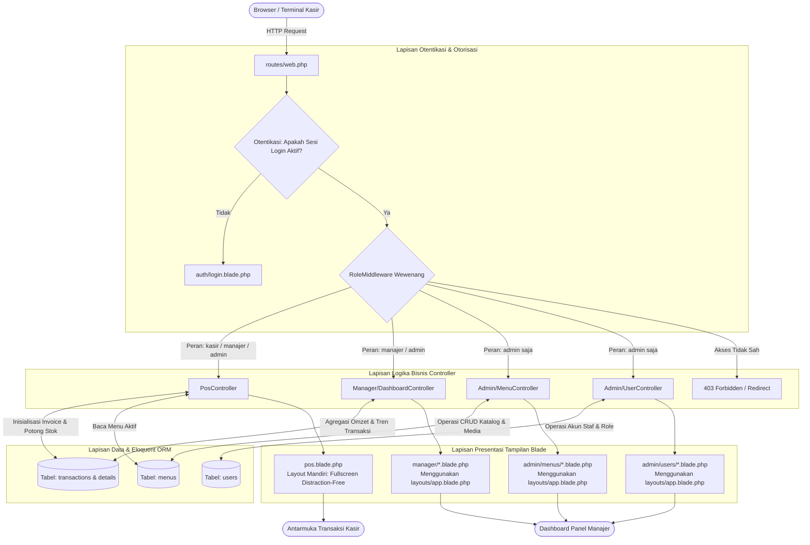

# 🗺️ PETA LENGKAP & PANDUAN PENGEMBANGAN POS RESTORAN
*Enterprise POS System — Architecture, File Mapping, Role Permissions & Developer Action Guide*

> **Tujuan Dokumen**: Dokumen ini merupakan buku panduan teknis (*Developer Runbook & Technical Playbook*) resmi untuk arsitektur, pemetaan kode, alur rute, manajemen hak akses multi-peran (**Admin**, **Manajer**, **Kasir**), serta pedoman operasional saat melakukan penambahan atau refaktorisasi fitur pada sistem POS Restoran.

---

## 📌 Daftar Isi Dokumen

```text
├── 1. Kredensial Akun Pengujian (Demo Environments)
├── 2. Matriks Hak Akses & Fitur (Role Permission Matrix)
├── 3. Katalog Rute & Endpoint Lengkap (URL Routing Registry)
├── 4. Pemetaan File & Tanggung Jawab Berdasarkan Role (File Architecture Mapping)
│   ├── 4.1 Role Kasir (Cashier Workstation)
│   ├── 4.2 Role Manajer (Analytics & Reporting)
│   ├── 4.3 Role Admin (Superuser & Master Data)
│   └── 4.4 Berkas Bersama & Fondasi Global (Shared Core)
├── 5. Skema Basis Data & Model Eloquent (Database Schema & Relations)
├── 6. Diagram Alur & Arsitektur Request Lifecycle
├── 7. Tabel Panduan Aksi Pengembang Profesional (Professional Developer Action Guide)
│   ├── 7.1 Matriks Panduan Pengembangan Fitur (Feature Engineering Matrix)
│   └── 7.2 Prosedur & Protokol Penerapan (Implementation Protocols)
├── 8. Catatan Kritis: Arsitektur Dual-Layout (Standalone vs Template)
└── 9. Lembar Contekan Perintah Terminal (Terminal Command Cheatsheet)
```

1. [🔑 1. Kredensial Akun Pengujian (Demo Environments)](#1--kredensial-akun-pengujian-demo-environments)
2. [🛡️ 2. Matriks Hak Akses & Fitur (Role Permission Matrix)](#2-️-matriks-hak-akses--fitur-role-permission-matrix)
3. [🌐 3. Katalog Rute & Endpoint Lengkap (URL Routing Registry)](#3--katalog-rute--endpoint-lengkap-url-routing-registry)
4. [📂 4. Pemetaan File & Tanggung Jawab Berdasarkan Role](#4--pemetaan-file--tanggung-jawab-berdasarkan-role)
   - [4.1 Role Kasir (`kasir`)](#41-role-kasir-kasir)
   - [4.2 Role Manajer (`manajer`)](#42-role-manajer-manajer)
   - [4.3 Role Admin (`admin`)](#43-role-admin-admin)
   - [4.4 Berkas Bersama & Fondasi Global (*Shared Core*)](#44-berkas-bersama--fondasi-global-shared-core)
5. [🗄️ 5. Skema Basis Data & Model Eloquent](#5-️-skema-basis-data--model-eloquent)
6. [📊 6. Diagram Alur & Arsitektur Request Lifecycle](#6--diagram-alur--arsitektur-request-lifecycle)
7. [🛠️ 7. Tabel Panduan Aksi Pengembang Profesional (Developer Action Guide)](#7-️-tabel-panduan-aksi-pengembang-profesional-developer-action-guide)
   - [7.1 Matriks Panduan Pengembangan Fitur Terperinci](#71-matriks-panduan-pengembangan-fitur-terperinci)
   - [7.2 Detail Prosedur & Checklist Implementasi Standar](#72-detail-prosedur--checklist-implementasi-standar)
8. [⚠️ 8. Catatan Kritis: Arsitektur Dual-Layout (Standalone vs Template)](#8-️-catatan-kritis-arsitektur-dual-layout-standalone-vs-template)
9. [💻 9. Lembar Contekan Perintah Terminal (Terminal Cheatsheet)](#9--lembar-contekan-perintah-terminal-terminal-cheatsheet)

---

## 1. 🔑 Kredensial Akun Pengujian (Demo Environments)

Kredensial bawaan berikut tersedia setelah menjalankan seeder (`php artisan db:seed`):

| No | Peran (*Role*) | Alamat Email | Kata Sandi (*Password*) | Halaman Pengalihan (*Landing Route*) | Deskripsi Tanggung Jawab |
|:--:|:--------------|:-------------|:-----------------------|:-----------------------------------|:--------------------------|
| **1** | <span style="color:#ef4444; font-weight:bold;">Admin</span> | `admin@resto.com` | `password` | [`/admin/menus`](file:///opt/lampp/htdocs/pos_resto/routes/web.php#L32-L35) | Hak penuh: konfigurasi menu, harga, stok, & manajemen akun staf. |
| **2** | <span style="color:#eab308; font-weight:bold;">Manajer</span> | `manajer@resto.com` | `password` | [`/manager/dashboard`](file:///opt/lampp/htdocs/pos_resto/routes/web.php#L38-L41) | Monitoring performa omzet, analisis transaksi, & audit riwayat penjualan. |
| **3** | <span style="color:#3b82f6; font-weight:bold;">Kasir</span> | `kasir@resto.com` | `password` | [`/pos`](file:///opt/lampp/htdocs/pos_resto/routes/web.php#L44-L47) | Front-line terminal kasir: input pesanan, checkout, cetak struk. |

> [!TIP]
> **Tombol Akses Cepat Demo**: Pada antarmuka masuk [`resources/views/auth/login.blade.php`](file:///opt/lampp/htdocs/pos_resto/resources/views/auth/login.blade.php), tersedia tombol otomatis 1-klik untuk memasukkan kredensial masing-masing peran tanpa mengetik manual.

---

## 2. 🛡️ Matriks Hak Akses & Fitur (Role Permission Matrix)

Aplikasi menerapkan sistem otentikasi berbasis peran (*Role-Based Access Control / RBAC*) yang dijaga oleh [`RoleMiddleware`](file:///opt/lampp/htdocs/pos_resto/app/Http/Middleware/RoleMiddleware.php):

| Modul & Fitur | Deskripsi Operasional | Kasir | Manajer | Admin | Kebijakan Keamanan & Middleware |
|:---|:---|:---:|:---:|:---:|:---|
| **Terminal Kasir POS** | Antarmuka transaksi menu, keranjang, kalkulasi uang & kembalian, QRIS modal, cetak struk | `GRANTED` ✅ | `GRANTED` ✅ | `GRANTED` ✅ | Dijaga oleh middleware `role:kasir,admin,manajer` |
| **Submit Checkout Transaksi** | Menyimpan struk transaksi, update stok menu, dan generate detail transaksi ke database | `GRANTED` ✅ | `GRANTED` ✅ | `GRANTED` ✅ | Endpoint `POST /pos/checkout` (`DB::transaction`) |
| **Dashboard Analitik & Omzet** | Visualisasi KPI penjualan (hari ini, bulan ini, total transaksi, chart omzet harian) | `FORBIDDEN` ❌ | `GRANTED` ✅ | `GRANTED` ✅ | Read-only. Akses kasir diarahkan ke halaman `/pos` |
| **Audit Riwayat Transaksi** | Tabel komprehensif seluruh invoice, filter rentang tanggal, filter metode bayar, modal detail | `FORBIDDEN` ❌ | `GRANTED` ✅ | `GRANTED` ✅ | Read-only. Dilengkapi modal rincian item |
| **Master Data Menu (CRUD)** | Tambah menu baru, ubah harga/kategori, toggle aktif/nonaktif, upload media gambar | `FORBIDDEN` ❌ | `FORBIDDEN` ❌ | `GRANTED` ✅ | Khusus Admin (`role:admin`). Termasuk upload gambar ke disk storage |
| **Manajemen Pengguna (CRUD)** | Buat akun kasir/manajer, reset kata sandi, ubah wewenang role, dan nonaktifkan akun | `FORBIDDEN` ❌ | `FORBIDDEN` ❌ | `GRANTED` ✅ | Khusus Admin (`role:admin`). Dilengkapi hashing bcrypt |

---

## 3. 🌐 Katalog Rute & Endpoint Lengkap (URL Routing Registry)

Semua rute aplikasi terpusat di dalam berkas [`routes/web.php`](file:///opt/lampp/htdocs/pos_resto/routes/web.php):

| Metode HTTP | Endpoint URL | Nama Rute (*Route Alias*) | Controller & Action | Peran (*RBAC*) | Fungsi & Dampak |
|:---:|:---|:---|:---|:---:|:---|
| `GET` | `/` | *-* | `Closure (Redirector)` | Tamu / Auth | Redirect pintar: `admin` → `/admin/menus`, `manajer` → `/manager/dashboard`, `kasir` → `/pos`. Jika belum login → `/login`. |
| `GET` | `/login` | `login` | [`AuthController@showLogin`](file:///opt/lampp/htdocs/pos_resto/app/Http/Controllers/AuthController.php) | Tamu (*Guest*) | Merender halaman form login interaktif. |
| `POST` | `/login` | *-* | [`AuthController@login`](file:///opt/lampp/htdocs/pos_resto/app/Http/Controllers/AuthController.php) | Tamu (*Guest*) | Memvalidasi kredensial pengguna dan menginisialisasi sesi. |
| `POST` | `/logout` | `logout` | [`AuthController@logout`](file:///opt/lampp/htdocs/pos_resto/app/Http/Controllers/AuthController.php) | Semua Role Terotentikasi | Menghapus sesi otentikasi dan mengembalikan ke login. |
| `GET` | `/pos` | `pos.index` | [`PosController@index`](file:///opt/lampp/htdocs/pos_resto/app/Http/Controllers/PosController.php) | `kasir`, `manajer`, `admin` | Menampilkan antarmuka terminal POS kasir (*Standalone Layout*). |
| `POST` | `/pos/checkout` | `pos.checkout` | [`PosController@store`](file:///opt/lampp/htdocs/pos_resto/app/Http/Controllers/PosController.php) | `kasir`, `manajer`, `admin` | Memproses pembayaran, memotong stok, menyimpan invoice ke tabel `transactions`. |
| `GET` | `/manager/dashboard` | `manager.dashboard` | [`Manager\DashboardController@index`](file:///opt/lampp/htdocs/pos_resto/app/Http/Controllers/Manager/DashboardController.php) | `manajer`, `admin` | Ringkasan statistik performa bisnis dan visualisasi grafik penjualan Chart.js. |
| `GET` | `/manager/transactions` | `manager.transactions` | [`Manager\DashboardController@transactions`](file:///opt/lampp/htdocs/pos_resto/app/Http/Controllers/Manager/DashboardController.php) | `manajer`, `admin` | Menampilkan daftar riwayat transaksi dengan filter tanggal & metode bayar. |
| `GET` | `/admin/menus` | `admin.menus.index` | [`Admin\MenuController@index`](file:///opt/lampp/htdocs/pos_resto/app/Http/Controllers/Admin/MenuController.php) | `admin` | Tabel manajemen katalog menu restoran. |
| `GET` | `/admin/menus/create` | `admin.menus.create` | [`Admin\MenuController@create`](file:///opt/lampp/htdocs/pos_resto/app/Http/Controllers/Admin/MenuController.php) | `admin` | Form input penambahan menu baru. |
| `POST` | `/admin/menus` | `admin.menus.store` | [`Admin\MenuController@store`](file:///opt/lampp/htdocs/pos_resto/app/Http/Controllers/Admin/MenuController.php) | `admin` | Validasi & persistensi menu baru ke basis data. |
| `GET` | `/admin/menus/{id}/edit` | `admin.menus.edit` | [`Admin\MenuController@edit`](file:///opt/lampp/htdocs/pos_resto/app/Http/Controllers/Admin/MenuController.php) | `admin` | Form perubahan data menu yang sudah terdaftar. |
| `PUT/PATCH` | `/admin/menus/{id}` | `admin.menus.update` | [`Admin\MenuController@update`](file:///opt/lampp/htdocs/pos_resto/app/Http/Controllers/Admin/MenuController.php) | `admin` | Menyimpan perubahan data menu dan pembaruan berkas foto. |
| `DELETE` | `/admin/menus/{id}` | `admin.menus.destroy` | [`Admin\MenuController@destroy`](file:///opt/lampp/htdocs/pos_resto/app/Http/Controllers/Admin/MenuController.php) | `admin` | Menghapus menu dari database beserta file gambar di storage. |
| `GET` | `/admin/users` | `admin.users.index` | [`Admin\UserController@index`](file:///opt/lampp/htdocs/pos_resto/app/Http/Controllers/Admin/UserController.php) | `admin` | Menampilkan daftar seluruh staf sistem dengan informasi perannya. |
| `GET` | `/admin/users/create` | `admin.users.create` | [`Admin\UserController@create`](file:///opt/lampp/htdocs/pos_resto/app/Http/Controllers/Admin/UserController.php) | `admin` | Form pembuatan akun staf baru (Kasir/Manajer/Admin). |
| `POST` | `/admin/users` | `admin.users.store` | [`Admin\UserController@store`](file:///opt/lampp/htdocs/pos_resto/app/Http/Controllers/Admin/UserController.php) | `admin` | Validasi dan pembuatan akun baru dengan hashing bcrypt. |
| `GET` | `/admin/users/{id}/edit` | `admin.users.edit` | [`Admin\UserController@edit`](file:///opt/lampp/htdocs/pos_resto/app/Http/Controllers/Admin/UserController.php) | `admin` | Form pengubahan profil atau reset kata sandi staf. |
| `PUT/PATCH` | `/admin/users/{id}` | `admin.users.update` | [`Admin\UserController@update`](file:///opt/lampp/htdocs/pos_resto/app/Http/Controllers/Admin/UserController.php) | `admin` | Menyimpan perubahan data profil atau pembaharuan kata sandi. |
| `DELETE` | `/admin/users/{id}` | `admin.users.destroy` | [`Admin\UserController@destroy`](file:///opt/lampp/htdocs/pos_resto/app/Http/Controllers/Admin/UserController.php) | `admin` | Menghapus akun pengguna dari database. |

---

## 4. 📂 Pemetaan File & Tanggung Jawab Berdasarkan Role

### 4.1 Role Kasir (`kasir`)
Workstation khusus operasional kasir untuk memproses transaksi pesanan pelanggan secara cepat, akurat, dan tanpa jeda.

| Layer Arsitektur | Berkas (*File Path*) | Simbol Kunci (*Classes / Methods / Elements*) | Tanggung Jawab Teknis |
|:---|:---|:---|:---|
| **Controller** | [`app/Http/Controllers/PosController.php`](file:///opt/lampp/htdocs/pos_resto/app/Http/Controllers/PosController.php) | `index()`, `store()` | Query menu aktif (`is_active = true`), manajemen keranjang via AJAX, pembuatan nomor invoice unik (`INV-YYYYMMDD-XXXX`), eksekusi `DB::transaction`. |
| **View (UI)** | [`resources/views/pos.blade.php`](file:///opt/lampp/htdocs/pos_resto/resources/views/pos.blade.php) | Keranjang Belanja, Modal Bayar, Preview Struk | Antarmuka kasir layar penuh (*standalone*), pencarian menu real-time, filter kategori, kalkulator kembalian, QRIS modal, dan cetak struk (format 58mm/80mm). |
| **Model Header** | [`app/Models/Transaction.php`](file:///opt/lampp/htdocs/pos_resto/app/Models/Transaction.php) | `user()`, `details()` | Representasi tabel `transactions` (`invoice_number`, `user_id`, `total_amount`, `payment_method`, `paid_amount`, `change_amount`, `status`). |
| **Model Detail** | [`app/Models/TransactionDetail.php`](file:///opt/lampp/htdocs/pos_resto/app/Models/TransactionDetail.php) | `transaction()`, `menu()` | Representasi item baris `transaction_details` (`menu_id`, `menu_name`, `price`, `quantity`, `subtotal`). |
| **Model Menu** | [`app/Models/Menu.php`](file:///opt/lampp/htdocs/pos_resto/app/Models/Menu.php) | `$fillable`, `details()` | Pengambilan entitas menu, filter ketersediaan, dan pemotongan stok otomatis setelah checkout. |

---

### 4.2 Role Manajer (`manajer`)
Pusat kontrol pemantauan performa bisnis, rekapitulasi data pendapatan finansial, dan audit transaksi.

| Layer Arsitektur | Berkas (*File Path*) | Simbol Kunci (*Classes / Methods / Elements*) | Tanggung Jawab Teknis |
|:---|:---|:---|:---|
| **Controller** | [`app/Http/Controllers/Manager/DashboardController.php`](file:///opt/lampp/htdocs/pos_resto/app/Http/Controllers/Manager/DashboardController.php) | `index()`, `transactions()` | Menghitung omzet hari ini, omzet bulanan, total volume pesanan, agregasi data grafik 7/30 hari terakhir, serta filter riwayat transaksi. |
| **View Dashboard**| [`resources/views/manager/dashboard.blade.php`](file:///opt/lampp/htdocs/pos_resto/resources/views/manager/dashboard.blade.php) | Kartu Metrik KPI, Canvas Chart.js, Tabel 10 Transaksi Terakhir | Visualisasi performa omzet keuangan, grafik tren pendapatan harian, dan ringkasan pesanan terkini. |
| **View Transaksi**| [`resources/views/manager/transactions.blade.php`](file:///opt/lampp/htdocs/pos_resto/resources/views/manager/transactions.blade.php) | Form Filter Tanggal & Metode Bayar, Modal Detail Invoice | Rekap transaksi komprehensif, pencarian nomor struk, filter transaksi tunai vs QRIS, serta rincian subtotal per item. |
| **Layout Induk** | [`resources/views/layouts/app.blade.php`](file:///opt/lampp/htdocs/pos_resto/resources/views/layouts/app.blade.php) | `@yield('content')`, Sidebar Dinamis, Top Navbar | Kerangka desain aplikasi terpusat bagi dashboard manajer dan halaman panel admin. |

---

### 4.3 Role Admin (`admin`)
Superuser dengan wewenang tak terbatas dalam manajemen entitas data operasional dan keamanan sistem.

| Layer Arsitektur | Berkas (*File Path*) | Simbol Kunci (*Classes / Methods / Elements*) | Tanggung Jawab Teknis |
|:---|:---|:---|:---|
| **Controller Menu**| [`app/Http/Controllers/Admin/MenuController.php`](file:///opt/lampp/htdocs/pos_resto/app/Http/Controllers/Admin/MenuController.php) | `index()`, `create()`, `store()`, `edit()`, `update()`, `destroy()` | Validasi input menu, pengunggahan dan pembaruan berkas gambar di disk storage, update status `is_active`. |
| **Controller User**| [`app/Http/Controllers/Admin/UserController.php`](file:///opt/lampp/htdocs/pos_resto/app/Http/Controllers/Admin/UserController.php) | `index()`, `create()`, `store()`, `edit()`, `update()`, `destroy()` | Manajemen akun staf pengguna, penetapan peran (`admin`/`manajer`/`kasir`), enkripsi kata sandi `Hash::make()`. |
| **Views Menu** | [`resources/views/admin/menus/`](file:///opt/lampp/htdocs/pos_resto/resources/views/admin/menus/) | `index.blade.php`, `create.blade.php`, `edit.blade.php` | Antarmuka CRUD katalog menu: tabel pratinjau gambar, input mata uang Rupiah, upload file gambar, selector status aktif. |
| **Views Pengguna**| [`resources/views/admin/users/`](file:///opt/lampp/htdocs/pos_resto/resources/views/admin/users/) | `index.blade.php`, `create.blade.php`, `edit.blade.php` | Antarmuka CRUD staf: badge penanda wewenang role, form pendaftaran staf, dan dialog ganti password. |

---

### 4.4 Berkas Bersama & Fondasi Global (*Shared Core*)
Komponen pondasi sistem yang mempengaruhi alur kerja lintas peran:

| Berkas (*File Path*) | Tipe & Lapisan | Peran Pengguna | Fungsi Pokok & Catatan Perubahan |
|:---|:---|:---|:---|
| [`routes/web.php`](file:///opt/lampp/htdocs/pos_resto/routes/web.php) | Rute Aplikasi | Semua Role | **Gerbang Utama**: Registrasi endpoint, penamaan route alias, dan pengelompokan middleware peran. |
| [`app/Http/Middleware/RoleMiddleware.php`](file:///opt/lampp/htdocs/pos_resto/app/Http/Middleware/RoleMiddleware.php) | Security Guard | Semua Role | **Penjaga Hak Akses**: Memvalidasi apakah wewenang user saat ini berhak mengeksekusi aksi terkait (Return 403 jika ilegal). |
| [`app/Http/Controllers/AuthController.php`](file:///opt/lampp/htdocs/pos_resto/app/Http/Controllers/AuthController.php) | Otentikasi | Semua Role | Manajemen alur login, logout, sesi browser, serta logika *smart redirection* berdasarkan wewenang peran. |
| [`app/Models/User.php`](file:///opt/lampp/htdocs/pos_resto/app/Models/User.php) | Eloquent Model | Semua Role | Entitas akun pengguna dengan helper wewenang: `isAdmin()`, `isManager()`, `isCashier()`. |
| [`resources/views/layouts/app.blade.php`](file:///opt/lampp/htdocs/pos_resto/resources/views/layouts/app.blade.php) | Master Blade View | Admin & Manajer | Template master: navigasi sidebar admin/manajer, top navigation bar, status pengguna login, modal logout. |
| [`resources/views/auth/login.blade.php`](file:///opt/lampp/htdocs/pos_resto/resources/views/auth/login.blade.php) | Public Blade View | Guest / Pengunjung | Form autentikasi modern dengan dukungan mode gelap (*dark theme*) dan tombol isi cepat kredensial demo. |
| [`public/css/dark-theme.css`](file:///opt/lampp/htdocs/pos_resto/public/css/dark-theme.css) | Stylesheet Asset | Semua Halaman | Variabel styling CSS untuk tema gelap restoran (background, modal surface, badge, card, border). |

---

## 5. 🗄️ Skema Basis Data & Model Eloquent

Sistem menggunakan 4 tabel inti yang saling berelasi secara konsisten:

| Nama Tabel | Berkas Migrasi | Model Eloquent Terkait | Struktur Kolom Kritis | Hubungan Relasional (*Entity Relationships*) |
|:---|:---|:---|:---|:---|
| **`users`** | [`0001_01_01_000000_create_users_table.php`](file:///opt/lampp/htdocs/pos_resto/database/migrations/0001_01_01_000000_create_users_table.php) | [`User`](file:///opt/lampp/htdocs/pos_resto/app/Models/User.php) | `id`, `name`, `email`, `role` (`'admin'`,`'manajer'`,`'kasir'`), `password`, `timestamps` | `hasMany(Transaction::class, 'user_id')` |
| **`menus`** | [`2026_09_24_000001_create_menus_table.php`](file:///opt/lampp/htdocs/pos_resto/database/migrations/2026_09_24_000001_create_menus_table.php) | [`Menu`](file:///opt/lampp/htdocs/pos_resto/app/Models/Menu.php) | `id`, `name`, `category`, `price`, `stock`, `image`, `is_active`, `timestamps` | `hasMany(TransactionDetail::class, 'menu_id')` |
| **`transactions`** | [`2026_09_24_000002_create_transactions_table.php`](file:///opt/lampp/htdocs/pos_resto/database/migrations/2026_09_24_000002_create_transactions_table.php) | [`Transaction`](file:///opt/lampp/htdocs/pos_resto/app/Models/Transaction.php) | `id`, `invoice_number`, `user_id`, `total_amount`, `payment_method` (`'cash'`,`'qris'`), `paid_amount`, `change_amount`, `status`, `timestamps` | `belongsTo(User::class, 'user_id')`<br>`hasMany(TransactionDetail::class, 'transaction_id')` |
| **`transaction_details`** | [`2026_09_24_000003_create_transaction_details_table.php`](file:///opt/lampp/htdocs/pos_resto/database/migrations/2026_09_24_000003_create_transaction_details_table.php) | [`TransactionDetail`](file:///opt/lampp/htdocs/pos_resto/app/Models/TransactionDetail.php) | `id`, `transaction_id`, `menu_id`, `menu_name`, `price`, `quantity`, `subtotal`, `timestamps` | `belongsTo(Transaction::class, 'transaction_id')`<br>`belongsTo(Menu::class, 'menu_id')` |

---

## 6. 📊 Diagram Alur & Arsitektur Request Lifecycle

Diagram alur berikut mengilustrasikan bagaimana sebuah HTTP Request dari browser diproses melalui rantai keamanan, controller, database, hingga menghasilkan tampilan Blade yang sesuai:



---

## 7. 🛠️ Tabel Panduan Aksi Pengembang Profesional (Developer Action Guide)

Gunakan panduan matriks di bawah ini sebagai **SOP (Standard Operating Procedure)** resmi saat hendak mengubah, menambah, atau merefaktorisasi fitur aplikasi:

### 7.1 Matriks Panduan Pengembangan Fitur Terperinci

| No | Skenario Pengembangan / Tugas | Layer Terlibat | Berkas yang Wajib Dimodifikasi (*Target Files*) | Prosedur Teknis & Perubahan Kode Kunci | Tingkat Risiko & Protokol Pengujian |
|:--:|:---|:---|:---|:---|:---:|
| **1** | **Kustomisasi Terminal / Keranjang POS** | `Frontend (Blade + JS)` | 1. [`resources/views/pos.blade.php`](file:///opt/lampp/htdocs/pos_resto/resources/views/pos.blade.php) | • Ubah tata letak item keranjang belanja.<br>• Sesuaikan script JS `updateCart()`, perhitungan diskon, atau pajak.<br>• Edit modal pembayaran tunai/kembalian.<br>• Format ulang template struk printer termal (`window.print()`). | <span style="color:#eab308; font-weight:bold;">SEDANG</span><br>Uji input kuantitas, kalkulasi kembalian, dan cetak pratinjau struk. |
| **2** | **Menambah Kategori Menu Baru** *(Contoh: 'Snack', 'Paket Hemat')* | `Frontend + Form Admin` | 1. [`resources/views/pos.blade.php`](file:///opt/lampp/htdocs/pos_resto/resources/views/pos.blade.php)<br>2. [`resources/views/admin/menus/create.blade.php`](file:///opt/lampp/htdocs/pos_resto/resources/views/admin/menus/create.blade.php)<br>3. [`resources/views/admin/menus/edit.blade.php`](file:///opt/lampp/htdocs/pos_resto/resources/views/admin/menus/edit.blade.php) | • Tambahkan pill button filter kategori baru di UI POS.<br>• Tambahkan opsi `<option value="Snack">` pada form input dan edit menu di admin panel. | <span style="color:#22c55e; font-weight:bold;">RENDAH</span><br>Buat menu baru berkategori baru, verifikasi muncul di tombol filter POS. |
| **3** | **Menambah Metode Pembayaran Baru** *(Contoh: 'Debit Card', 'Transfer BCA')* | `Database + Backend + Frontend` | 1. `database/migrations/...update_payment_method.php`<br>2. [`app/Http/Controllers/PosController.php`](file:///opt/lampp/htdocs/pos_resto/app/Http/Controllers/PosController.php)<br>3. [`resources/views/pos.blade.php`](file:///opt/lampp/htdocs/pos_resto/resources/views/pos.blade.php)<br>4. [`resources/views/manager/transactions.blade.php`](file:///opt/lampp/htdocs/pos_resto/resources/views/manager/transactions.blade.php) | • Ubah enum kolom `payment_method` via migration baru.<br>• Perbarui validasi form di `PosController@store`: `'payment_method' => 'in:cash,qris,debit'`.<br>• Tambahkan tombol radio/opsi bayar pada modal checkout POS.<br>• Tambahkan opsi filter pada halaman riwayat transaksi manajer. | <span style="color:#ef4444; font-weight:bold;">TINGGI</span><br>Lakukan migrasi DB, checkout dengan metode baru, verifikasi riwayat transaksi. |
| **4** | **Menambah Atribut/Kolom Menu Baru** *(Contoh: 'barcode', 'sku', 'hpp')* | `Database + Model + Controller + Views` | 1. `database/migrations/...add_columns_to_menus.php`<br>2. [`app/Models/Menu.php`](file:///opt/lampp/htdocs/pos_resto/app/Models/Menu.php)<br>3. [`app/Http/Controllers/Admin/MenuController.php`](file:///opt/lampp/htdocs/pos_resto/app/Http/Controllers/Admin/MenuController.php)<br>4. [`resources/views/admin/menus/index.blade.php`](file:///opt/lampp/htdocs/pos_resto/resources/views/admin/menus/index.blade.php)<br>5. [`resources/views/admin/menus/create.blade.php`](file:///opt/lampp/htdocs/pos_resto/resources/views/admin/menus/create.blade.php)<br>6. [`resources/views/admin/menus/edit.blade.php`](file:///opt/lampp/htdocs/pos_resto/resources/views/admin/menus/edit.blade.php) | • Buat migrasi penambahan kolom baru pada tabel `menus`.<br>• Daftarkan atribut ke dalam properti `$fillable` di `Menu.php`.<br>• Tambahkan aturan validasi baru di `MenuController@store` & `@update`.<br>• Tambahkan field input di view Blade form tambah/edit menu dan kolom tabel index. | <span style="color:#eab308; font-weight:bold;">SEDANG</span><br>Uji submit form tanpa dan dengan nilai atribut baru. Pastikan tersimpan rapi. |
| **5** | **Menambah Item Menu pada Sidebar Navigasi** | `Frontend Layout Dual-File` | ⚠️ **Wajib di 2 File Sekaligus:**<br>1. [`resources/views/layouts/app.blade.php`](file:///opt/lampp/htdocs/pos_resto/resources/views/layouts/app.blade.php)<br>2. [`resources/views/pos.blade.php`](file:///opt/lampp/htdocs/pos_resto/resources/views/pos.blade.php) | • Tambahkan tag `<li><a href="...">` dengan ikon dan link rute baru pada sidebar di `layouts/app.blade.php`.<br>• Duplikasi blok navigasi tersebut ke dalam sidebar mandiri di `pos.blade.php`. | <span style="color:#eab308; font-weight:bold;">SEDANG</span><br>Login sebagai admin dan kasir, pastikan navigasi muncul di kedua tampilan. |
| **6** | **Mengubah Rumus Agregasi / Grafik Dashboard** | `Backend Controller + Frontend Chart.js` | 1. [`app/Http/Controllers/Manager/DashboardController.php`](file:///opt/lampp/htdocs/pos_resto/app/Http/Controllers/Manager/DashboardController.php)<br>2. [`resources/views/manager/dashboard.blade.php`](file:///opt/lampp/htdocs/pos_resto/resources/views/manager/dashboard.blade.php) | • Modifikasi query Eloquent (misal: laba kotor, rata-rata transaksi harian, filter 90 hari).<br>• Kirim variabel baru ke view.<br>• Sesuaikan dataset Chart.js (sumbu X tanggal, sumbu Y total omzet, opsi warna). | <span style="color:#22c55e; font-weight:bold;">RENDAH</span><br>Buka dashboard manajer, pastikan angka agregat dan render grafik sesuai. |
| **7** | **Menambah Role Baru** *(Contoh: 'supervisor', 'kitchen')* | `Full-Stack Arsitektur` | 1. `database/migrations/...update_user_roles.php`<br>2. [`app/Models/User.php`](file:///opt/lampp/htdocs/pos_resto/app/Models/User.php)<br>3. [`app/Http/Middleware/RoleMiddleware.php`](file:///opt/lampp/htdocs/pos_resto/app/Http/Middleware/RoleMiddleware.php)<br>4. [`app/Http/Controllers/AuthController.php`](file:///opt/lampp/htdocs/pos_resto/app/Http/Controllers/AuthController.php)<br>5. [`routes/web.php`](file:///opt/lampp/htdocs/pos_resto/routes/web.php)<br>6. [`resources/views/admin/users/create.blade.php`](file:///opt/lampp/htdocs/pos_resto/resources/views/admin/users/create.blade.php) | • Perluas enum role di tabel `users`.<br>• Buat helper function `isSupervisor()` di `User.php`.<br>• Tambahkan pengecekan peran di `RoleMiddleware.php` & logika redirect `AuthController.php`.<br>• Buat grup routing baru dengan prefix peran terkait di `web.php`.<br>• Tambahkan opsi role baru di form pendaftaran pengguna admin. | <span style="color:#ef4444; font-weight:bold;">KRITIS</span><br>Uji alur otentikasi role baru, verifikasi akses rute terproteksi dan 403 handling. |

---

### 7.2 Detail Prosedur & Checklist Implementasi Standar

Saat mengeksekusi modifikasi pada salah satu skenario di atas, ikuti alur standar berikut:

```text
1. Analisis Kebutuhan ──► 2. Modifikasi DB/Migration ──► 3. Update Model & Controller ──► 4. Modifikasi Views ──► 5. Clear Cache & Uji Coba
```

- [ ] **Langkah 1 (Database)**: Selalu gunakan migrasi baru (`php artisan make:migration`), jangan pernah mengubah migration lama yang sudah berjalan di production.
- [ ] **Langkah 2 (Mass Assignment)**: Pastikan setiap kolom baru didaftarkan pada array `$fillable` di model Eloquent terkait.
- [ ] **Langkah 3 (Validasi Input)**: Tambahkan validasi ketat pada Controller dengan pesan error yang jelas.
- [ ] **Langkah 4 (Layout Konsistensi)**: Jika mengubah navigasi sidebar, periksa **kedua tempat**: `layouts/app.blade.php` dan `pos.blade.php`.
- [ ] **Langkah 5 (Cache Flushing)**: Jalankan `php artisan optimize:clear` untuk memastikan cache view dan route tersegarkan.

---

## 8. ⚠️ Catatan Kritis: Arsitektur Dual-Layout

Aplikasi ini mengadopsi dua strategi rendering tampilan yang berbeda sesuai kebutuhan pengalaman pengguna (*User Experience*):

```text
┌─────────────────────────────────────────────────────────────┐
│                    STRUKTUR LAYOUT SISTEM                   │
├──────────────────────────────┬──────────────────────────────┤
│    Admin & Manajer Panels    │     Terminal Kasir POS       │
├──────────────────────────────┼──────────────────────────────┤
│   @extends('layouts.app')    │    Standalone HTML Blade     │
│   Shared Sidebar & Topbar    │    Embedded Custom UI        │
│   Standard Admin Experience  │    Distraction-Free POS      │
└──────────────────────────────┴──────────────────────────────┘
```

| Parameter Perbandingan | Panel Admin & Manajer | Terminal Kasir POS ([`pos.blade.php`](file:///opt/lampp/htdocs/pos_resto/resources/views/pos.blade.php)) |
|:---|:---|:---|
| **Pola Pewarisan (*Inheritance*)** | Mewarisi master layout via `@extends('layouts.app')` | Berkas independen (*Standalone* penuh ~980 baris) |
| **Sumber Kode Sidebar** | Komponen terpusat di dalam [`layouts/app.blade.php`](file:///opt/lampp/htdocs/pos_resto/resources/views/layouts/app.blade.php) | Di-hardcode langsung di dalam blok markup [`pos.blade.php`](file:///opt/lampp/htdocs/pos_resto/resources/views/pos.blade.php) |
| **Alasan Desain (*Design Rationale*)** | Konsistensi navigasi menu administratif dan pelaporan | Memaksimalkan area kerja monitor kasir (*full-screen view*), kecepatan render bebas overhead, dan fokus tinggi kasir |
| **Konsekuensi Perubahan Kode** | Mengubah `layouts/app.blade.php` **tidak akan** mengubah tampilan halaman POS kasir. | **PENTING**: Jika Anda menambah atau memodifikasi tautan navigasi sidebar, Anda **wajib memperbaruinya di kedua file tersebut**. |

> [!CAUTION]
> **PERINGATAN SINKRONISASI NAVIGASI:**
> Jangan pernah menganggap perubahan pada `layouts/app.blade.php` otomatis diterapkan pada halaman kasir. Selalu periksa elemen sidebar internal di `resources/views/pos.blade.php` agar menu tetap konsisten bagi staf yang berpindah antara POS dan halaman manajemen.

---

## 9. 💻 Lembar Contekan Perintah Terminal (Terminal Cheatsheet)

Jalankan perintah-perintah berikut dari direktori root proyek (`/opt/lampp/htdocs/pos_resto`):

| Perintah Artisan / Bash | Waktu Penggunaan / Tujuan |
|:---|:---|
| `php artisan route:list` | Memeriksa seluruh rute aktif, nama route alias, serta guard middleware yang terdaftar. |
| `php artisan optimize:clear` | **Sangat Dianjurkan**: Menghapus seluruh cache (views compiled, config, cache routes) setelah mengedit kode. |
| `php artisan storage:link` | Membuat symlink folder `storage/app/public` ke `public/storage` agar upload gambar menu tampil di browser. |
| `php artisan migrate:fresh --seed` | ⚠️ **Reset Total**: Menghapus seluruh tabel, menjalankan migrasi ulang, dan menginjeksi akun demo serta data menu default. |
| `php artisan make:migration <nama_migrasi>` | Membuat berkas migrasi baru untuk penambahan tabel atau kolom baru. |
| `php artisan test` | Menjalankan automated test suite untuk memastikan fungsi pembayaran dan otentikasi tidak regresi. |

---

*Panduan resmi ini dipelihara oleh tim pengembang inti POS Resto. Jika ada penambahan modul, perubahan tabel basis data, atau kebijakan akses baru, segera perbarui dokumen ini guna menjamin kontinuitas pengetahuan rekayasa perangkat lunak.*
